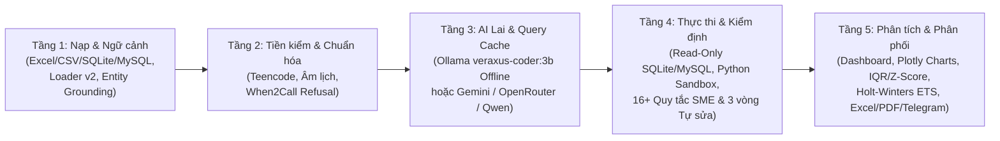

# Veraxus — Trợ lý AI Phân tích Excel & Dữ liệu Kinh doanh cho SME Việt Nam

> *Zero-Hallucination Vietnamese Business Analytics Assistant for Spreadsheets, POS Exports & Databases — Cloud & 100% Offline Local AI*

[](https://veraxus-agent.streamlit.app/)
[](https://www.python.org/)
[](training/README.md)
[](https://colab.research.google.com/github/Phongkarazz/AI-business-agent-/blob/main/training/Veraxus_Stage4_Colab_L4_Train.ipynb)
[](tests/)

**Veraxus** giúp chủ cửa hàng, hộ kinh doanh và doanh nghiệp nhỏ & vừa (F&B, Nhà thuốc, Vật liệu xây dựng, Bán lẻ, Sổ thu chi) kết nối trực tiếp file **Excel (`.xlsx`)**, **CSV** xuất từ POS/kế toán (KiotViet, Sapo, MISA...) hoặc cơ sở dữ liệu (**SQLite / MySQL**), rồi đặt câu hỏi bằng **tiếng Việt tự nhiên** (gõ tay hoặc giọng nói) để nhận ngay:

- Bảng số liệu đã được **tính toán và kiểm chứng** trên dữ liệu thật (**không bịa số**).
- **Biểu đồ tương tác**, bảng điều hành tự động thích ứng (**Adaptive Dashboard**), **cảnh báo bất thường** và **dự báo xu hướng**.
- Xuất báo cáo **CSV / Excel / PDF** và gửi thẳng qua **Telegram Bot / Email** chỉ với 1 chạm.

> 💡 **Không cần biết SQL hay Power BI:** Người dùng làm việc hoàn toàn bằng tiếng Việt trên file Excel/sổ bán hàng quen thuộc. Toàn bộ câu lệnh SQL chỉ chạy **ngầm** như một động cơ tính toán & đối soát chặt chẽ để AI tuyệt đối không ước lượng hay tự bịa số liệu (người làm kế toán/IT vẫn có thể bấm xem/sửa công thức đối soát bất cứ lúc nào).

---

## 🎯 Tại sao chọn Veraxus? (4 Lợi thế Cốt lõi)

1. **Đọc trực tiếp file Excel "rối" chuẩn Việt Nam (`datamate/loader.py`)**
   - Xử lý sổ nhiều sheet, ô gộp (merged cells), tiêu đề nhiều dòng, bảng lịch sử nhiều kỳ (`source_sheet`), định dạng ngày hỗn hợp (`dd/mm/yyyy`, Excel serial date).
   - Tự động giữ số `0` đầu của số điện thoại (`09xx...`), nhận diện dòng tiền âm/dương của sao kê ngân hàng & ví điện tử (`so_tien < 0`), và đọc file quy ước `README.md` riêng của từng cửa hàng.
2. **Kiến trúc 5 tầng Chống Ảo Giác (Zero-Hallucination SQL-First + Python Sandbox)**
   - **Tiền kiểm When2Call (Preflight Refusal)**: Tự động từ chối trung thực và chỉ rõ trường còn thiếu nếu người dùng hỏi chỉ số không tồn tại (VD: hỏi biên lợi nhuận khi bảng chỉ có giá bán) hoặc hỏi ngoài khoảng ngày dữ liệu.
   - **Hậu kiểm 16+ quy tắc nghiệp vụ SME & Sanity Bounds**: Tự động loại đơn hủy/đơn trả, chống đếm trùng dòng chi tiết đơn hàng (`COUNT(DISTINCT ma_don)`), chống nhân trùng `so_luong * thanh_tien`, xử lý xếp hạng giá trị chi từ dòng tiền âm (`SUM(ABS(...))` thay vì để tổng âm lộn ngược bảng xếp hạng), che cụm từ ghép cấu trúc tiếng Việt (tránh `"Danh sách"` khớp nhầm thành đối tượng `'Sách'`), bảo vệ không ép `JOIN` qua bảng rời rạc không có khóa nối, và chống gộp mất kỳ `source_sheet`.
   - **Tự sửa lỗi âm thầm (Silent Repair Loop)**: Tối đa 3 vòng tự kiểm định & sửa truy vấn + CTE / Python Sandbox dự phòng (Read-Only `SELECT`/`WITH`, timeout an toàn, chặn hoàn toàn `DROP`/`DELETE`/`UPDATE`).
3. **Bản địa hóa Tiếng Việt & Nghiệp vụ SME sâu**
   - Chuẩn hóa teencode/không dấu (`hnay`, `dthu`, `sp`, `sl`), chuyển đổi **lịch Âm – Dương** (Tết, Rằm, Mùng 1), xếp hạng thứ tự (`đứng thứ 2`, `cao thứ 3`), so sánh cực trị & vượt/dưới mức trung bình, và nối danh bạ theo biệt danh/tên thường gọi (`LEFT JOIN + COALESCE`).
4. **AI Lai (Hybrid LLM) & Chế độ Offline 100% Bảo mật**
   - Hỗ trợ **4 nhà cung cấp**: **Ollama (Local AI Offline)**, **Google Gemini**, **OpenRouter**, và **Alibaba Qwen**.
   - **Minh bạch quyền riêng tư**:
     - Khi dùng **Cloud AI**, hệ thống chỉ gửi cấu trúc lược đồ cột (`schema`) kèm tối thiểu các từ khóa/giá trị danh mục khớp với câu hỏi — **không đẩy toàn bộ bảng dữ liệu giao dịch thô lên cloud**.
     - Khi bật **Ollama Offline** với mô hình tinh chỉnh riêng **`veraxus-coder:3b` / `7b`** (tối ưu `num_ctx 8192`, nén lược đồ thông minh và tự động khôi phục lỗi tràn context HTTP 400): **0 VNĐ phí API**, **0 byte rời khỏi máy nội bộ**, phù hợp tuyệt đối cho sổ sách tài chính nhạy cảm.

---

## 🏗️ Kiến trúc Vận hành Lõi (5 Tầng Năng lực)



---

## ✨ Danh mục Tính năng Nổi bật trên MVP

| Nhóm năng lực | Chi tiết triển khai thực tế trong hệ thống |
| :--- | :--- |
| **1. Nạp Dữ liệu & Bộ mẫu SME** | Hỗ trợ `.xlsx`, `.csv`, `.sqlite`/`.db`, MySQL Local/Cloud (`localhost`, Docker, Aiven, Railway) kèm file quy ước `README.md`. Tích hợp sẵn **3 bộ mẫu SME Việt** (*Cà phê Phố Việt*, *Nhà thuốc An Tâm*, *VLXD Minh Phát*) và các CSDL đa bảng (*Awesome Chocolates*, *Yến Sào*, *Northwind*). |
| **2. Hỏi đáp Tiếng Việt & Giọng nói** | Hỗ trợ gõ tự nhiên (có dấu, không dấu, teencode), nhập bằng giọng nói (**Web Speech API**), giao diện song ngữ **Việt / Anh** (`src/i18n.py`) và các nút **gợi ý câu hỏi tiếp theo** bám đúng từng bảng đang có. |
| **3. Adaptive Dashboard đồng bộ Chat** | Tự động dựng bảng tổng quan KPI, top sản phẩm/khách hàng/kênh bán/công nợ và xu hướng ngày khi vừa kết nối dữ liệu; dùng chung bộ lọc đơn hợp lệ để số liệu giữa **Dashboard** và **Chat** khớp nhau 100%. |
| **4. Biểu đồ Thông minh & Zoom Modal** | Tự động chọn Plotly Bar / Line / Donut / Scatter (`MAX_BAR_CATEGORIES = 100`), xử lý nhãn trục X thông minh không bị trùng mã phiếu, kèm cửa sổ **Phóng to & Phân tích chuyên sâu** bám sát miền dữ liệu. |
| **5. Phát hiện Bất thường & Dự báo 95% CI** | Kiểm định ngoại lai **IQR / Z-Score**, cảnh báo sụt giảm/tăng vọt theo kỳ, rủi ro tập trung `> 50%`, và dự báo chuỗi thời gian **Holt-Winters & Exponential Smoothing (ETS)** với dải tin cậy 95%. |
| **6. Đối soát Công thức & Bộ nhớ Mẫu** | Giao diện mặc định gọn nhẹ cho chủ shop, đồng thời cho phép mở xem/sửa lại SQL đối soát (`Chi tiết Kỹ thuật`), lưu mẫu truy vấn kèm **Query Cache** và phản hồi đánh giá (`Hài lòng` / `Cần sửa`). |
| **7. Xuất Báo cáo & Chia sẻ 1-Click** | Xuất trực tiếp **CSV (UTF-8)**, **Excel (`.xlsx`)** định dạng chuẩn, **PDF** (ReportLab + Plotly Kaleido PNG) và gửi thẳng báo cáo qua **Telegram Bot** hoặc **Email (SMTP/Gmail)**. |

---

## 🗺️ Lộ trình Phát triển Sản phẩm (Roadmap)

- **Giai đoạn 1 — MVP Đang chạy (Hiện tại):** Nạp Excel/CSV/SQLite/MySQL, hỏi đáp tiếng Việt chống bịa số 5 tầng, mô hình Offline `veraxus-coder:3b`, Dashboard tự động, Anomaly & Dự báo ETS, xuất PDF/Excel/Telegram.
- **Giai đoạn 2 — Kết nối Trực tiếp (Tiếp theo):** Đồng bộ **1-chạm Google Sheets**, kết nối luồng xuất dữ liệu KiotViet / Sapo / MISA và lịch gửi báo cáo tự động qua Zalo/Telegram.
- **Giai đoạn 3 & 4 — Chuyên sâu Ngành & Nền tảng:** Bộ KPI/câu hỏi dựng sẵn theo từng ngành (Nhà thuốc, F&B, VLXD), phân quyền đa chi nhánh (RBAC) và gói triển khai Private GPU/Server cho chuỗi doanh nghiệp.

---

## 📁 Cấu trúc Thư mục Dự án

```text
AI-business-agent-/
├── app.py                              # Điểm khởi chạy Streamlit UI & điều hướng chính
├── Dockerfile                          # Đóng gói container triển khai
├── requirements.txt                    # Danh sách thư viện Python phụ thuộc
├── data/
│   ├── agent_memory.db                 # SQLite lưu bộ nhớ mẫu truy vấn đã kiểm chứng
│   ├── demo_businesses/                # 3 bộ mẫu SME Việt kèm README.md quy ước
│   │   ├── cafe_pho_viet/              # F&B: bao_cao_ban_hang.xlsx
│   │   ├── nha_thuoc_an_tam/           # Nhà thuốc: hoa_don_ban.csv, phieu_nhap_thuoc.csv
│   │   └── vlxd_minh_phat/             # VLXD: so_theo_doi_vlxd.xlsx
│   ├── northwind*.sql & yen_sao.*      # CSDL đa bảng phục vụ kiểm thử quan hệ
│   └── synthetic_train/                # Tập dữ liệu tổng hợp nội bộ
├── datamate/                           # Động cơ lõi DataMate & Chống Ảo Giác
│   ├── loader.py                       # Nạp Excel rối, CSV, SQLite, MySQL, SĐT/ngày/source_sheet
│   ├── schema_context.py               # Hồ sơ lược đồ, đồ thị JOIN, chỉ mục thực thể, tiền mặt âm/dương
│   ├── agent.py                        # Bộ phân tích ý định, 16+ kiểm định ngữ nghĩa & tự sửa 3 vòng
│   ├── sql_executor.py                 # Thực thi Read-Only an toàn + UDF NORM_VN / ROUND_HALF_UP
│   ├── python_sandbox.py               # Thực thi Python có kiểm soát cho bảng ma trận / phép tính phức tạp
│   ├── temporal.py                     # Chuẩn hóa thời gian tiếng Việt & lịch Âm–Dương
│   ├── llm_backend.py                  # Wrapper gọi LLM theo chuẩn Structured Output
│   ├── stage4_dataset_builder.py       # Tạo dữ liệu SFT & When2Call DPO thuần tổng hợp
│   ├── evaluator_pa.py / run_eval.py   # Đánh giá Execution Accuracy (EX) & kiểm chuẩn
│   └── splits.py                       # Chia tập đánh giá chuẩn
├── src/                                # Lớp Phân tích, Giao diện & Kết nối
│   ├── config.py / config_store.py     # Cấu hình 4 AI providers (Ollama, Gemini, OpenRouter, Qwen)
│   ├── i18n.py                         # Song ngữ Việt / Anh
│   ├── database/                       # Upload workspace, MySQL/SQLite connector, demo loaders
│   ├── llm/                            # Bridge DataMate <-> UI, dynamic memory, gợi ý câu hỏi
│   ├── analytics/                      # Anomaly (IQR/Z-Score), ETS Forecast, Export XLSX/PDF, Telegram/Email
│   ├── multi_agent/                    # Kiến trúc điều phối tác tử phân tích mở rộng
│   ├── visualization/                  # Biểu đồ Plotly thông minh & modal phân tích chi tiết
│   └── ui/                             # Onboarding, Sidebar, Components, Evolution & CRM views
├── training/                           # Pipeline Fine-Tune mô hình Local Offline (Stage 4)
│   ├── Veraxus_Stage4_Colab_L4_Train.ipynb  # Notebook huấn luyện SFT + DPO -> GGUF Q4_K_M trên Colab L4
│   ├── train_colab_l4.py               # Script huấn luyện & xuất Modelfile
│   ├── Modelfile.template              # Template nạp GGUF vào Ollama (num_ctx 8192)
│   ├── import_to_ollama.sh             # Script import nhanh veraxus-coder:3b lên máy Mac/Linux
│   └── datasets/                       # Bộ SFT & When2Call DPO nén (.jsonl.gz) thuần tổng hợp
└── tests/                              # Bộ kiểm thử tự động (Unit, Integration, UI, Privacy)
```

---

## 🚀 Hướng dẫn Cài đặt & Khởi chạy

### 1. Chạy trên máy cá nhân (Local)

```bash
git clone https://github.com/Phongkarazz/AI-business-agent-.git
cd AI-business-agent-
pip install -r requirements.txt
streamlit run app.py
```

- **Lần đầu mở**: Chọn nguồn dữ liệu (3 bộ mẫu SME, upload file Excel/CSV/SQLite của bạn, hoặc kết nối MySQL) và chọn AI Provider (Cloud API Key hoặc Ollama Offline).
- **Từ các lần sau**: Tự động bỏ qua Onboarding và mở thẳng giao diện làm việc. Có thể đổi cấu hình bất kỳ lúc nào qua nút **`Thiết lập`** trên thanh bên trái.

### 2. Chạy AI Offline 100% với Ollama (Khuyên dùng cho dữ liệu nhạy cảm)

Bạn có thể cài [Ollama](https://ollama.com/) và dùng model có sẵn (`ollama pull qwen2.5-coder:3b`), hoặc nạp model **`veraxus-coder:3b`** đã được fine-tune riêng cho Veraxus (xem hướng dẫn chi tiết tại [training/README.md](training/README.md)):

```bash
# Sau khi tải file GGUF từ Colab L4:
bash training/import_to_ollama.sh ~/Downloads/veraxus-coder-3b-q4_k_m.gguf veraxus-coder:3b
```

Trong Veraxus, chọn nhà cung cấp **`Ollama (Local AI Offline)`** → **`veraxus-coder:3b`** (nếu máy chưa nạp `veraxus-coder:3b`, hệ thống tự fallback an toàn sang `qwen2.5-coder:3b`).

### 3. Chạy bằng Docker

```bash
docker build -t veraxus-app .
docker run -p 8501:8501 veraxus-app
```

---

## 🧪 Kiểm thử Tự động & Bảo mật Dữ liệu

Toàn bộ logic SQL-first, bóc tách Excel rối, xử lý dòng tiền âm/dương, chống ảo giác và kiểm tra không rò rỉ dữ liệu nhạy cảm đều được bảo vệ bằng bộ kiểm thử tự động:

```bash
# Chạy toàn bộ bộ kiểm thử Unit & Integration (116+ test cases)
python3 -m unittest discover -s tests -v

# Chạy kiểm thử pipeline huấn luyện Stage 4 & kiểm tra chống rò rỉ dữ liệu cá nhân
python3 -m unittest tests/test_stage4_training_pipeline.py -v
```
