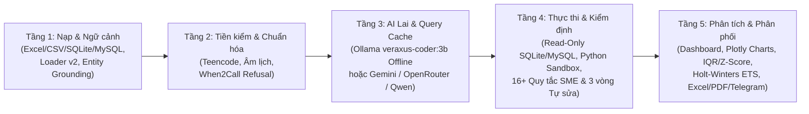

# Veraxus — Trợ lý AI Phân tích Excel & Dữ liệu Kinh doanh cho SME Việt Nam

Bản dùng thử trực tuyến: https://veraxus-agent.streamlit.app/

**Veraxus** giúp chủ cửa hàng, hộ kinh doanh và doanh nghiệp nhỏ & vừa (F&B, Nhà thuốc, Vật liệu xây dựng, Bán lẻ, Sổ thu chi) kết nối trực tiếp file **Excel (`.xlsx`)**, **CSV** xuất từ phần mềm bán hàng/kế toán (KiotViet, Sapo, MISA...) hoặc cơ sở dữ liệu (**SQLite / MySQL**), rồi đặt câu hỏi bằng **tiếng Việt tự nhiên** (gõ tay hoặc giọng nói) để nhận:

- Bảng số liệu được **tính toán và kiểm chứng** trên dữ liệu thật (**không bịa số**).
- **Biểu đồ tương tác**, bảng tổng quan tự động thích ứng (**Adaptive Dashboard**), **cảnh báo bất thường** và **dự báo xu hướng**.
- Xuất báo cáo **CSV / Excel / PDF** và gửi thẳng qua **Telegram Bot** hoặc **Email**.

Người dùng làm việc hoàn toàn bằng tiếng Việt trên file Excel/sổ bán hàng quen thuộc, không cần biết SQL hay Power BI. Toàn bộ câu lệnh SQL chạy ngầm như một lớp tính toán & đối soát chặt chẽ để AI không ước lượng hay tự bịa số liệu (kế toán hoặc bộ phận kỹ thuật vẫn có thể mở xem và chỉnh lại câu truy vấn đối soát khi cần).

---

## Các vấn đề cốt lõi Veraxus giải quyết

1. **Đọc trực tiếp file Excel nhiều sheet / nhiều định dạng (`datamate/loader.py`)**
   - Xử lý sổ nhiều sheet, ô gộp (merged cells), tiêu đề nhiều dòng, bảng lịch sử chia kỳ theo `source_sheet`, định dạng ngày hỗn hợp (`dd/mm/yyyy`, Excel serial date).
   - Tự động giữ số `0` đầu của số điện thoại (`09xx...`), nhận diện dòng tiền âm/dương của sao kê ngân hàng & ví điện tử (`so_tien < 0`), và đọc file quy ước `README.md` riêng của từng cửa hàng.
2. **Kiến trúc 5 tầng kiểm định chống bịa số (SQL-First + Python Sandbox)**
   - **Tiền kiểm (When2Call / Preflight Refusal)**: Tự từ chối trung thực và chỉ rõ trường còn thiếu nếu câu hỏi yêu cầu chỉ số không có trong dữ liệu (ví dụ: hỏi biên lợi nhuận khi bảng chỉ có giá bán) hoặc nằm ngoài khoảng ngày thực tế.
   - **Hậu kiểm 16+ quy tắc nghiệp vụ SME & kiểm tra giá trị**: Tự động loại đơn hủy/đơn trả, chống đếm trùng dòng chi tiết đơn hàng (`COUNT(DISTINCT ma_don)`), chống nhân trùng `so_luong * thanh_tien`, xử lý xếp hạng khoản chi từ dòng tiền âm (`SUM(ABS(...))` thay vì để tổng âm đảo ngược thứ hạng), che từ ghép cấu trúc tiếng Việt (tránh `"Danh sách"` khớp nhầm thành `'Sách'`), không ép `JOIN` qua bảng rời rạc không có khóa nối, và chống gộp mất kỳ `source_sheet`.
   - **Tự sửa lỗi âm thầm (Silent Repair Loop)**: Tối đa 3 vòng tự kiểm định & sửa truy vấn + CTE / Python Sandbox dự phòng (Read-Only `SELECT`/`WITH`, có timeout an toàn, chặn `DROP`/`DELETE`/`UPDATE`).
3. **Bản địa hóa Tiếng Việt & Nghiệp vụ SME**
   - Chuẩn hóa teencode/không dấu (`hnay`, `dthu`, `sp`, `sl`), chuyển đổi **lịch Âm – Dương** (Tết, Rằm, Mùng 1), xếp hạng thứ tự (`đứng thứ 2`, `cao thứ 3`), so sánh cực trị & vượt/dưới mức trung bình, và nối danh bạ theo biệt danh/tên thường gọi (`LEFT JOIN + COALESCE`).
4. **Hỗ trợ cả Cloud AI và Offline 100% qua Ollama**
   - Tích hợp **4 nhà cung cấp**: **Ollama (Local AI Offline)**, **Google Gemini**, **OpenRouter**, và **Alibaba Qwen**.
   - **Quyền riêng tư**:
     - Khi dùng **Cloud AI**, hệ thống chỉ gửi cấu trúc cột (`schema`) kèm tối thiểu các từ khóa/danh mục khớp với câu hỏi — không đẩy toàn bộ bảng dữ liệu giao dịch thô lên cloud.
     - Khi bật **Ollama Offline** với mô hình tinh chỉnh riêng **`veraxus-coder:3b` / `7b`** (`num_ctx 8192`, nén lược đồ thông minh và tự khôi phục lỗi tràn context HTTP 400): chạy 100% trên máy nội bộ, không tốn phí API và không gửi dữ liệu ra ngoài.

---

## Kiến trúc hệ thống (5 tầng xử lý)



---

## Tính năng hiện có trên MVP

| Nhóm chức năng | Chi tiết triển khai |
| :--- | :--- |
| **Nạp dữ liệu & Bộ mẫu SME** | Hỗ trợ `.xlsx`, `.csv`, `.sqlite`/`.db`, MySQL Local/Cloud (`localhost`, Docker, Aiven, Railway) kèm file quy ước `README.md`. Có sẵn **3 bộ mẫu SME Việt** (*Cà phê Phố Việt*, *Nhà thuốc An Tâm*, *VLXD Minh Phát*) và các CSDL đa bảng (*Awesome Chocolates*, *Yến Sào*, *Northwind*). |
| **Hỏi đáp Tiếng Việt & Giọng nói** | Hỗ trợ gõ tự nhiên (có dấu, không dấu, teencode), nhập bằng giọng nói (**Web Speech API**), giao diện song ngữ **Việt / Anh** (`src/i18n.py`) và gợi ý câu hỏi tiếp theo bám sát từng bảng. |
| **Adaptive Dashboard đồng bộ Chat** | Tự tạo bảng tổng quan KPI, xếp hạng sản phẩm/khách hàng/kênh bán/công nợ và xu hướng ngày khi nạp dữ liệu; dùng chung bộ lọc đơn hợp lệ để số liệu giữa **Dashboard** và **Chat** khớp nhau 100%. |
| **Biểu đồ & Phân tích phóng to** | Tự chọn Plotly Bar / Line / Donut / Scatter (`MAX_BAR_CATEGORIES = 100`), lọc nhãn trục X thông minh tránh trùng mã phiếu, kèm cửa sổ phóng to giải thích sát ngữ cảnh dữ liệu. |
| **Phát hiện Bất thường & Dự báo** | Kiểm định ngoại lai **IQR / Z-Score**, cảnh báo biến động mạnh theo kỳ, rủi ro tập trung `> 50%`, và dự báo chuỗi thời gian **Holt-Winters & ETS** với dải tin cậy 95%. |
| **Đối soát công thức & Bộ nhớ mẫu** | Giao diện mặc định gọn cho chủ shop, có tùy chọn mở xem/sửa lại SQL đối soát (`Chi tiết Kỹ thuật`), lưu mẫu truy vấn kèm **Query Cache** và phản hồi đánh giá (`Hài lòng` / `Cần sửa`). |
| **Xuất báo cáo & Gửi nhanh** | Xuất **CSV (UTF-8)**, **Excel (`.xlsx`)**, **PDF** (ReportLab + Plotly Kaleido PNG) và gửi trực tiếp qua **Telegram Bot** hoặc **Email (SMTP/Gmail)**. |

---

## Lộ trình phát triển (Roadmap)

- **Giai đoạn 1 — MVP (Hiện tại):** Nạp Excel/CSV/SQLite/MySQL, hỏi đáp tiếng Việt chống bịa số 5 tầng, mô hình Offline `veraxus-coder:3b`, Dashboard tự động, Anomaly & Dự báo ETS, xuất PDF/Excel/Telegram.
- **Giai đoạn 2 — Kết nối trực tiếp:** Đồng bộ **Google Sheets** chỉ với 1 chạm, kết nối luồng xuất dữ liệu KiotViet / Sapo / MISA và lịch gửi báo cáo định kỳ qua Zalo/Telegram.
- **Giai đoạn 3 & 4 — Chuyên sâu theo ngành:** Bộ KPI và câu hỏi mẫu theo từng ngành (Nhà thuốc, F&B, VLXD), phân quyền đa chi nhánh (RBAC) và gói triển khai Private GPU/Server cho doanh nghiệp.

---

## Cấu trúc thư mục dự án

```text
AI-business-agent-/
├── app.py                              # Điểm khởi chạy Streamlit UI & điều hướng chính
├── Dockerfile                          # Đóng gói container triển khai
├── requirements.txt                    # Danh sách thư viện Python phụ thuộc
├── data/
│   ├── agent_memory.db                 # SQLite lưu bộ nhớ mẫu truy vấn đã kiểm chứng
│   ├── demo_businesses/                # 3 bộ mẫu SME Việt kèm README.md quy ước
│   │   ├── cafe_pho_viet/              # F&B: bao_cao_ban_hang.xlsx
│   │   ├── nha_thuoc_an_tam/           # Nhà thuốc: hoa_don_ban.csv, phieu_nhap_thuoc.csv
│   │   └── vlxd_minh_phat/             # VLXD: so_theo_doi_vlxd.xlsx
│   ├── northwind*.sql & yen_sao.*      # CSDL đa bảng phục vụ kiểm thử quan hệ
│   └── synthetic_train/                # Tập dữ liệu tổng hợp nội bộ
├── datamate/                           # Động cơ lõi DataMate & Chống Ảo Giác
│   ├── loader.py                       # Nạp Excel rối, CSV, SQLite, MySQL, SĐT/ngày/source_sheet
│   ├── schema_context.py               # Hồ sơ lược đồ, đồ thị JOIN, chỉ mục thực thể, dòng tiền âm/dương
│   ├── agent.py                        # Phân tích ý định, 16+ kiểm định ngữ nghĩa & tự sửa 3 vòng
│   ├── sql_executor.py                 # Thực thi Read-Only an toàn + UDF NORM_VN / ROUND_HALF_UP
│   ├── python_sandbox.py               # Thực thi Python có kiểm soát cho bảng ma trận / phép tính phức tạp
│   ├── temporal.py                     # Chuẩn hóa thời gian tiếng Việt & lịch Âm–Dương
│   ├── llm_backend.py                  # Wrapper gọi LLM theo chuẩn Structured Output
│   ├── stage4_dataset_builder.py       # Tạo dữ liệu SFT & When2Call DPO thuần tổng hợp
│   ├── evaluator_pa.py / run_eval.py   # Đánh giá Execution Accuracy (EX) & kiểm chuẩn
│   └── splits.py                       # Chia tập đánh giá chuẩn
├── src/                                # Lớp Phân tích, Giao diện & Kết nối
│   ├── config.py / config_store.py     # Cấu hình 4 AI providers (Ollama, Gemini, OpenRouter, Qwen)
│   ├── i18n.py                         # Song ngữ Việt / Anh
│   ├── database/                       # Upload workspace, MySQL/SQLite connector, demo loaders
│   ├── llm/                            # Bridge DataMate <-> UI, dynamic memory, gợi ý câu hỏi
│   ├── analytics/                      # Anomaly (IQR/Z-Score), ETS Forecast, Export XLSX/PDF, Telegram/Email
│   ├── multi_agent/                    # Kiến trúc điều phối tác tử phân tích mở rộng
│   ├── visualization/                  # Biểu đồ Plotly thông minh & modal phân tích chi tiết
│   └── ui/                             # Onboarding, Sidebar, Components, Evolution & CRM views
├── training/                           # Pipeline Fine-Tune mô hình Local Offline (Stage 4)
│   ├── Veraxus_Stage4_Colab_L4_Train.ipynb  # Notebook huấn luyện SFT + DPO -> GGUF Q4_K_M trên Colab L4
│   ├── train_colab_l4.py               # Script huấn luyện & xuất Modelfile
│   ├── Modelfile.template              # Template nạp GGUF vào Ollama (num_ctx 8192)
│   ├── import_to_ollama.sh             # Script import nhanh veraxus-coder:3b lên máy Mac/Linux
│   └── datasets/                       # Bộ SFT & When2Call DPO nén (.jsonl.gz) thuần tổng hợp
└── tests/                              # Bộ kiểm thử tự động (Unit, Integration, UI, Privacy)
```

---

## Hướng dẫn cài đặt & khởi chạy

### 1. Chạy trên máy cá nhân (Local)

```bash
git clone https://github.com/Phongkarazz/AI-business-agent-.git
cd AI-business-agent-
pip install -r requirements.txt
streamlit run app.py
```

- **Lần đầu mở**: Chọn nguồn dữ liệu (3 bộ mẫu SME, upload file Excel/CSV/SQLite của bạn, hoặc kết nối MySQL) và chọn AI Provider (Cloud API Key hoặc Ollama Offline).
- **Từ các lần sau**: Hệ thống tự động bỏ qua Onboarding và mở thẳng giao diện làm việc. Có thể đổi cấu hình bất kỳ lúc nào qua nút `Thiết lập` trên thanh bên trái.

### 2. Chạy AI Offline qua Ollama

Cài [Ollama](https://ollama.com/) và dùng model có sẵn (`ollama pull qwen2.5-coder:3b`), hoặc nạp model **`veraxus-coder:3b`** đã fine-tune riêng cho Veraxus (chi tiết xem tại [training/README.md](training/README.md)):

```bash
# Sau khi tải file GGUF từ Colab L4:
bash training/import_to_ollama.sh ~/Downloads/veraxus-coder-3b-q4_k_m.gguf veraxus-coder:3b
```

Trong Veraxus, chọn nhà cung cấp `Ollama (Local AI Offline)` → `veraxus-coder:3b` (nếu chưa nạp model này, hệ thống tự fallback sang `qwen2.5-coder:3b`).

### 3. Chạy bằng Docker

```bash
docker build -t veraxus-app .
docker run -p 8501:8501 veraxus-app
```

---

## Kiểm thử tự động

```bash
# Chạy toàn bộ bộ kiểm thử Unit & Integration (116+ test cases)
python3 -m unittest discover -s tests -v

# Chạy kiểm thử pipeline Stage 4 & kiểm tra chống rò rỉ dữ liệu riêng tư
python3 -m unittest tests/test_stage4_training_pipeline.py -v
```
